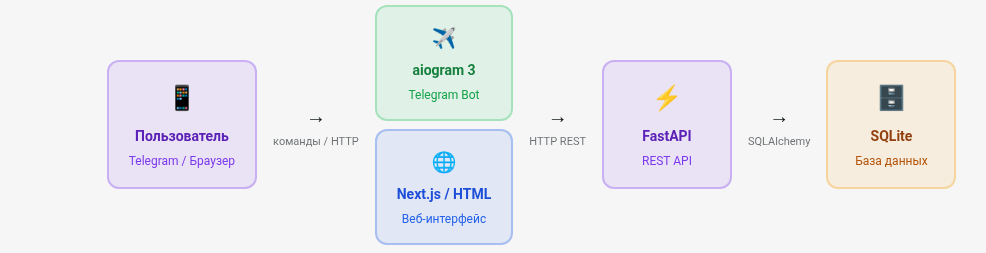

1. **Архитектура**  


**Целевые пользователи**

Один пользователь или команда до 5 человек. Используют Telegram ежедневно. Хотят добавлять задачи без переключения между приложениями.

**Основные функции**

CRUD задач через бота. Статусы: активна / выполнена. Веб-дашборд с графиком выполнения за неделю. REST API для интеграций.

**User stories**

Как пользователь я хочу добавить задачу одной командой. Как пользователь я хочу видеть список без выполненных. Как пользователь я хочу посмотреть прогресс за неделю на сайте.

**Технические ограничения**

SQLite в разработке (PostgreSQL в проде). Бот работает через polling (не webhook). Авторизация — по Telegram user_id. Без регистрации и паролей.

**Ключевые принципы архитектуры:**

- **Единственный источник правды — база данных.** Бот и веб читают данные через один и тот же API, а не напрямую из БД.
- **Бот — клиент API, не самостоятельный сервис.** Это позволяет переиспользовать логику и тестировать её через Swagger.
- **FastAPI — единственная точка входа в данные.** Вся бизнес-логика живёт здесь, не размазана по боту и веб-клиенту.


&nbsp;

2. **Структура папок проекта**

*Создай структуру папок для проекта taskbot по схеме выше. Только папки и пустые файлы **init**.py, без кода.*

```bash
taskbot/
├── backend/                    # FastAPI приложение
│   ├── app/
│   │   ├── __init__.py
│   │   ├── main.py             # Точка входа FastAPI
│   │   ├── database.py         # Подключение к БД, сессия
│   │   ├── models.py           # SQLAlchemy модели
│   │   ├── schemas.py          # Pydantic схемы (валидация)
│   │   ├── crud.py             # CRUD операции с БД
│   │   └── routers/
│   │       ├── __init__.py
│   │       └── tasks.py        # Роутер /tasks
│   ├── alembic/                # Миграции базы данных
│   │   ├── versions/
│   │   └── env.py
│   ├── alembic.ini
│   └── requirements.txt
│
├── bot/                        # Telegram бот (aiogram 3)
│   ├── __init__.py
│   ├── main.py                 # Запуск бота, polling
│   ├── config.py               # Токен, URL API
│   ├── api_client.py           # HTTP-клиент к FastAPI
│   └── handlers/
│       ├── __init__.py
│       ├── tasks.py            # /add, /list, /done, /delete
│       └── stats.py            # /stats
│
├── frontend/                   # Веб-интерфейс
│   ├── index.html              # Дашборд (или Next.js проект)
│   └── static/
│
├── tasks.db                    # SQLite файл (в .gitignore)
├── .env                        # Секреты: TOKEN, DATABASE_URL
├── .gitignore
└── README.md
```


&nbsp;

**3. Модели SQLAlchemy**

Я строю REST API для управления задачами. Напиши SQLAlchemy (версия 2.x) модели для файла `app/models/[models.py](http://models.py)`. Нужны две модели:

- **User** — пользователь: id (PK), email (уникальный), username, created_at (дата создания)
- **Task** — задача: id (PK), title (название), description (описание, необязательное), is_done (выполнена ли, по умолчанию False), created_at, user_id (FK на User)

Используй DeclarativeBase, современный синтаксис mapped_column и Mapped. Также напиши файл `app/[database.py](http://database.py)` с подключением к SQLite и созданием сессии через dependency injection.


**4. Pydantic схемы: валидация данных**

Напиши Pydantic v2 схемы для модели Task в файл `app/schemas/[task.py](http://task.py)`. Нужны три класса: `TaskCreate` (title обязательный, description и user_id обязательные), `TaskUpdate` (все поля опциональные — для частичного обновления), `TaskResponse` (возвращает все поля включая id и created_at). Используй `model_config = ConfigDict(from_attributes=True)` для совместимости с SQLAlchemy.


**5. FastAPI приложение и CRUD API**

Напиши FastAPI роутер для задач в файл `app/routers/[tasks.py](http://tasks.py)`. Нужны четыре эндпоинта: `GET /tasks` (список всех задач пользователя по user_id), `POST /tasks` (создать задачу), `PUT /tasks/{task_id}` (обновить задачу, если не найдена — 404), `DELETE /tasks/{task_id}` (удалить, если не найдена — 404). Используй схемы TaskCreate, TaskUpdate, TaskResponse и dependency injection для сессии БД. Возвращай правильные HTTP-статусы: 201 при создании, 204 при удалении.


6. **Тестируем через curl**
7. **Пример работы с ошибкой**

Запустил сервер командой `uvicorn app.main:app --reload` и получил ошибку. Вот полный traceback: [вставь текст ошибки]. Вот содержимое файла, где ошибка: [вставь код файла]. Исправь проблему и объясни, в чём была ошибка.


8. **Aiogram 3**

Ты пишешь Telegram-бота на aiogram 3 (Python). Бот управляет задачами. Уже есть:

- FastAPI бэкенд с эндпоинтами: POST /api/users/register, GET /api/tasks, POST /api/tasks, PATCH /api/tasks/{id}/complete
- Авторизация через заголовок X-Bot-Secret
- Структура БД: users (telegram_id, username, first_name), tasks (id, user_id, title, description, is_done)

Напиши файл `handlers/add_task.py`с FSM для команды /add. Состояния: waiting_title, waiting_description. После ввода описания — вызов POST /api/tasks через httpx.AsyncClient. Обработай ошибку сети. Используй aiogram 3 синтаксис.  
Папка лежит по пути ./taskbot/backend/requirements.txt.


**Что проверять в ответе агента:**

**StatesGroup** — состояния объявлены через класс, наследующий `StatesGroup`, каждое состояние — `State()`.

**state: FSMContext** — хэндлеры принимают этот аргумент для работы с состоянием.

**await state.clear()** — в конце диалога состояние сбрасывается, иначе пользователь «застрянет».

**async with httpx.AsyncClient()** — клиент создаётся как контекстный менеджер, соединение корректно закрывается.

**Типичная ошибка агента:** может использовать aiogram 2 синтаксис (декораторы через `dp.message_handler`). Уточни: «только aiogram 3».